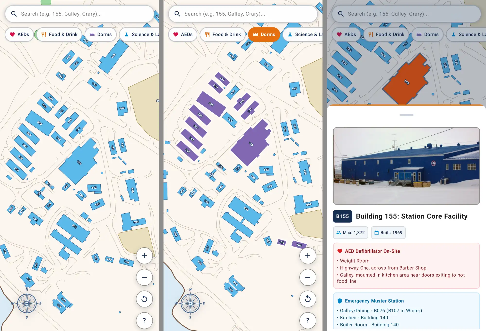

# McMurdo Station Map - Android App

An **offline** and lightweight Android map for McMurdo Station, Antarctica.

This was built primarily for first time station personnel trying to navigate town. The McMurdo intranet USAP web map is great on desktop, but doesn't work well on mobile, not to mention the lack of WiFi outside. This app brings the entire station map, facility directory, photos, and info PDFs right to your phone without needing a network connection.



---

## Features

- **100% Offline**: All station SVGs, building photographs, facility details, and PDF info sheets are bundled directly inside the APK.
- **Touch Friendly Map Controls**
- **Category Filters**: Tap category chips to highlight station facilities:
  - ❤️ **AEDs**: Defibrillator locations across station.
  - 🍴 **Food & Drink**: Building 155 Galley, Coffee House (B107), Southern Exposure (B108), etc.
  - 🛏️ **Dorms**: All dorms and housing units (including B155, B201–B211, B305).
  - 🔬 **Science & Labs**: Crary Science Center (B001) and other support buildings.
  - ➕ **Medical / Clinic**: Medical facility (B085), hyperbaric chamber (B142), and ambulance bay.
  - 🏋️ **Gym & Fitness**: Weight rooms, climbing wall (B075), etc.
  - 🚬 **Smoking Shelters**: B700, B701, B702.
- **Search Bar**: Search by number (`155`, `001`, `305`) or common terms/nicknames.
- **Building Info Modals**: Tap a structure to view its name, photo, built year, max occupancy, AED location, emergency muster info, and facility description.
- **Offline PDF Viewer**: Opens building PDF info sheets in your phone's PDF viewer, all offline.

---

## Installation

Download the [latest APK release from the GitHub releases page HERE](https://github.com/jwidess/mcmurdo-map/releases/latest). Two editions are available:
- **Full** (`McMurdoStationMap-full.apk`, ~30 MB): Includes all station photos, full map, building directory, and all 82 building information PDFs.
- **Slim** (`McMurdoStationMap-slim.apk`, ~16 MB): Includes all station photos, full map, building directory, but **NO PDF building information sheets** to reduce download size.

Copy the APK to your phone and install from a file manager or use ADB:

```bash
# Install Full
adb install -r McMurdoStationMap-full.apk

# Or install Slim
adb install -r McMurdoStationMap-slim.apk
```

---

## Build from Source

This project uses Gradle with Kotlin and Jetpack Compose Material 3. There are two app versions, `full` and `slim`:

### Build Both Versions
```powershell
# Windows
.\gradlew.bat assembleDebug --offline
```

This compiles both versions under `app/build/outputs/apk/`:
- **Full Debug**: `app/build/outputs/apk/full/debug/app-full-debug.apk`
- **Slim Debug**: `app/build/outputs/apk/slim/debug/app-slim-debug.apk`

---

### Build a Specific Version

```powershell
# Build Full only (Debug or Release)
.\gradlew.bat assembleFullDebug --offline
.\gradlew.bat assembleFullRelease --offline

# Build Slim only (Debug or Release)
.\gradlew.bat assembleSlimDebug --offline
.\gradlew.bat assembleSlimRelease --offline
```

### Installing via ADB
```bash
# Flash Full Debug
adb install -r app/build/outputs/apk/full/debug/app-full-debug.apk

# Or Flash Slim Debug
adb install -r app/build/outputs/apk/slim/debug/app-slim-debug.apk
```

---

## Updating Station Assets

If USAP publishes new station data or map updates in the future, you can refresh all bundled assets using the included Python scripts:

```bash
# Sync station JSON data, building photos, and info PDFs from the intranet map
python scripts/sync_station_assets.py

# Re-generate optimized mobile map HTML & SVG
python scripts/create_mobile_map_html.py

# Re-generate launcher and splash icons
python scripts/generate_high_res_icons.py
```

---

## Disclaimer

This is an independent open-source project and is not affiliated with, endorsed by, or officially associated with the United States Antarctic Program (USAP) or the National Science Foundation (NSF).

---

## AI Disclaimer: 
This project was developed with significant work from AI code generation tools. However, I have done much testing to verify that the map functions and renders appropriately, however as I can't test on every Android device out there, bugs will occur.

---

*Stay warm out there!*
